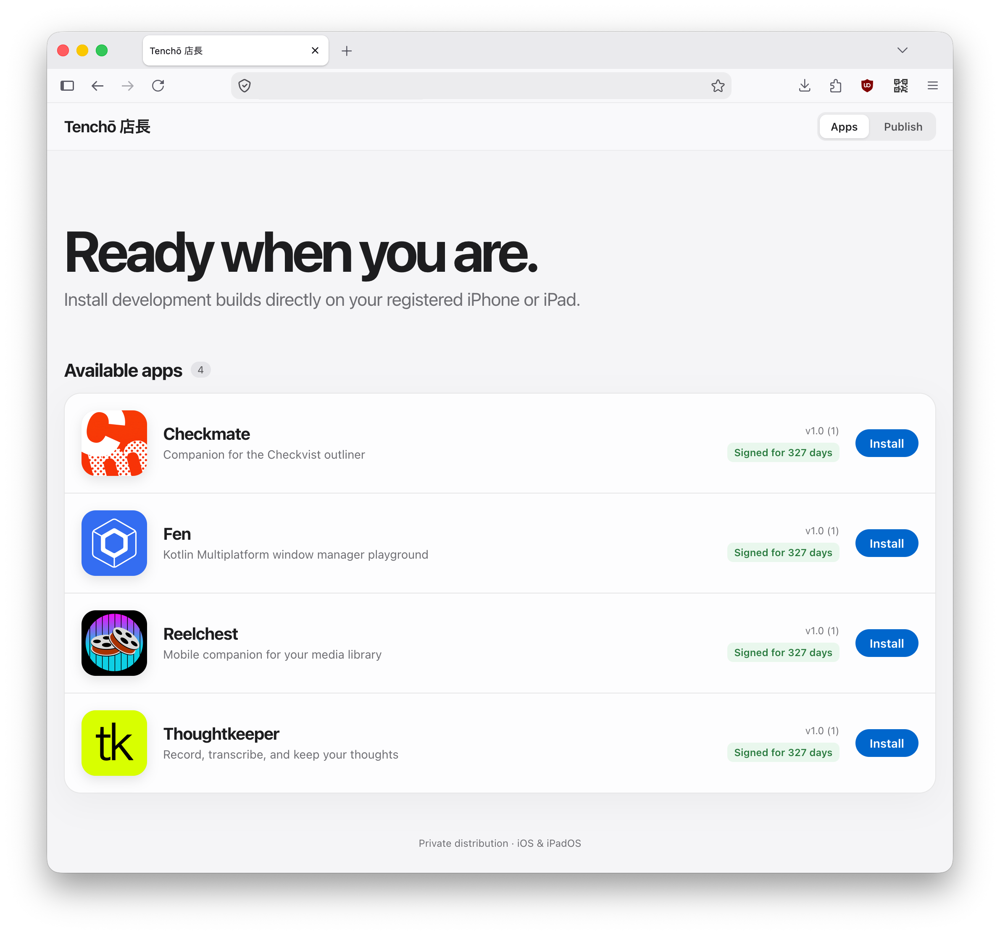

# Tenchou

Tenchou is a small, self-hosted catalog for installing development or ad-hoc
signed iOS applications over the air. It uses a React/TypeScript frontend with
TanStack Router and Query, and a Kotlin/Ktor backend.



## Development

```sh
./kotlin run
cd frontend && npm install && npm run dev
```

The Vite development server proxies `/api`, `/artifacts`, `/install`, and
`/instructions.md` to Ktor on port 8080.

## Production

The Ktor backend is built, tested, run, and packaged with JetBrains' Kotlin
Toolchain 0.13.0-dev-4333. The checked-in `./kotlin` wrapper pins and verifies
the toolchain distribution.

Production images keep the Vite output in `/app/web`, outside the JVM and
native executables. `TENCHOU_WEB_DIR` selects that directory and defaults to
`frontend/dist` for local packaged-server runs. This keeps frontend delivery
independent from backend compilation and packaging.

Persist `/data` and expose the service through HTTPS. iOS rejects over-the-air
installation manifests and IPA URLs that are not served over HTTPS.

## Setting up an iOS app

Whenever setting up Tenchou publishing for an app, **always ask the user whether
they also want in-app auto-updating**: automatic checks for newer builds and an
Update button that opens the iOS installer. Implement it if they accept, or
continue with publishing alone if they decline. Record the choice in the app's
project instructions; respect an answer already given during setup.

The guide at `/instructions.md` (also shown on the Publish page) includes the
complete integration recipe and a Swift helper. Its source is
[`src/Instructions.kt`](./src/Instructions.kt). It covers build-number reservation,
numeric `CFBundleVersion` comparison against `GET /api/apps`, launch/foreground
and periodic checks, and opening the returned `installUrl` with a catalog fallback.
It also explains the Kotlin Multiplatform equivalents used by Thoughtkeeper.

The user taps Update, confirms the iOS prompt, and reopens the app after
installation. State should be saved before the handoff, and existing signing
and registered-device requirements still apply.

## Upload API

`POST /api/apps` accepts multipart fields `ipa`, `title`, `subtitle`, and an
optional `icon`. See `/instructions.md` on a running server for the complete
build and upload recipe.

`POST /api/builds/{bundleId}/reserve` atomically reserves and returns the next
numeric build for an app. Build scripts can pass the returned `build` value to
Xcode as `CURRENT_PROJECT_VERSION` before uploading the resulting IPA.

[`tenchou.example.sh`](./tenchou.example.sh) is a reusable one-command Xcode
archive, export, and upload example. Copy it into an iOS project and provide
the required Xcode container, scheme, and development team as environment
variables documented at the top of the script.
